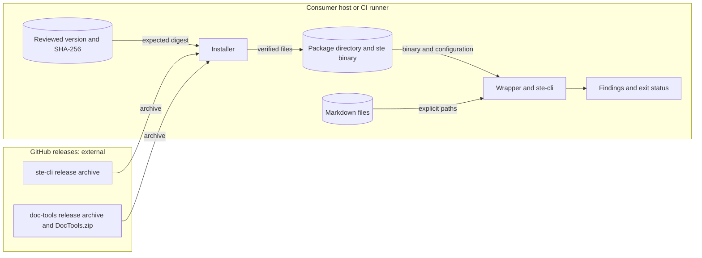

# Package architecture

doc-tools gives three repositories one source for documentation checks and agent guidance.
Each consumer keeps its product vocabulary, contracts, exceptions, and publication.

## Components

| Component | Interface | Dependency | Failure behavior |
| --- | --- | --- | --- |
| STE wrapper `tools/ste-lint.sh` | Explicit paths and ste-cli options | ste-cli binary, `.ste.yml` | No path: exit 2. Findings: exit 1. |
| STE installer `tools/install-ste.sh` | None | GitHub release download, SHA-256 tool | Mismatch: exit 1, no binary. Unsupported platform: exit 2. |
| Vale style `vale/DocTools/` | Vale `Packages` and `BasedOnStyles` | Consumer Vale installation | Vale reports the findings. |
| Skill `skills/documentation/` | Claude Code plugin, Codex skill installer | Agent client | The client reports installation errors. |
| Release workflow | Git tag and release assets | release-please, `git archive` | The workflow fails and attaches no assets. |

The package adds no linter, rule engine, configuration schema, or service.
ste-cli owns the STE checks. Vale owns the style checks. The skill guides authors.

## Data flows

Text alternative: the consumer downloads the doc-tools archive and compares it with its reviewed SHA-256.
The installer downloads the ste-cli archive and compares it with a pinned SHA-256.
Only verified files enter the package directory.
The wrapper reads explicit Markdown paths and the package configuration.
It writes findings and an exit status to the terminal or CI log.
Document text does not leave the host.

The trust boundary is between GitHub releases and the consumer host.
A second boundary is between the consumer's documents and the analyzer.
The analyzer reads documents only and does not change them.

## Security

| Asset | Threat | Control | Verification |
| --- | --- | --- | --- |
| Consumer host | A changed ste-cli archive runs code | Pinned SHA-256 check before extraction | `test_installer_rejects_bad_download_before_execution` |
| Consumer host | A changed doc-tools archive | Consumer-recorded SHA-256 check before extraction | Install guide step 4 |
| Package directory | A partial binary after a failed install | Extraction to a temporary directory, then one rename | Code review of `install-ste.sh` |
| Consumer documents | An accidental scan of a large tree | The wrapper refuses a call with no path | `test_no_paths_cannot_start_a_corpus_walk` |
| Consumer documents | Text sent to a remote service | `dictionary: false`, `analyzer: false`, no network in the wrapper | `.ste.yml` and test review |
| Check result | A local `.ste.yml` changes the rules | The wrapper always passes `--config` | `test_package_config_applies_from_a_consumer_directory` |
| Repository | Leaked credentials or unsafe workflows | gitleaks, actionlint, CodeQL, secret scanning, push protection | Required CI checks |

Residual risks:

- The installer trusts an installed `ste` binary without a new checksum check.
  A user who can write the package directory can replace it.
- The first consumer SHA-256 record trusts the release at that time.
- Vale does not verify the `DocTools.zip` digest.

## Decisions

- [0001: Share existing documentation tools in one package](decisions/0001-shared-documentation-package.md)
